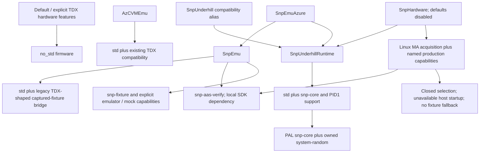

# Frozen feature and backend selection

Actual definitions: [MigTD features](../../../src/migtd/Cargo.toml) and
[PAL features](../../../src/pal/Cargo.toml). The complete gate/dependency/image
references are pinned in the [inventory](freeze-inventory.json).

| Selection | Build type | Current disposition |
|---|---|---|
| TDX hardware | `no_std` | Existing firmware paths retained; accepted T4.19 32-build CI matrix |
| `AzCVMEmu` | `std` | Existing TDX userspace compatibility retained |
| `SnpEmuAzure` | `std` | Explicit fixture compatibility plus Underhill runtime; no common V6 success |
| `SnpHardware` | `std` | Independent production-shaped selection; host-unavailable exit 2 |
| `SnpUnderhillRuntime` / alias | `std` | Runtime/PID1 support, not implicit fixture or qualified production selection |
| PAL `snp-core` | `std` | Shared SNP types/contracts and system RNG; no implicit captured fixture |
| PAL `snp-aas-verify` | `std` | SDK capability, not a working common V6 adapter |

Production must use `--no-default-features --features SnpHardware`.
[Compile-time guards](../../../src/migtd/src/lib.rs) reject mixed hardware,
TDX and fixture/emulator selections and release RA-bypass configurations;
[PAL guards](../../../src/pal/src/lib.rs) independently reject hardware plus
fixture/TDX capability. PAL aliases preserve their explicit implications.

Accepted T4.19 evidence has 57 feature/dependency/external-API checks,
including expected negative exits. Its native normal/build inventories have
237 emulator packages and 187 production packages. Production has local AAS
SDK/native crypto dependencies and no TAV graph. These are resolved build
dependencies, not proof every dependency is linked into the final ELF.

Separate release ELF manifests pin actual hashes, toolchain, environment,
fixture scans and production startup. They are **not** versioned P2.2 bundles:
kernel, initramfs, deployed runtime contents, shutdown and hardware RNG
qualification remain later work. No new builds are claimed by T4.20.
