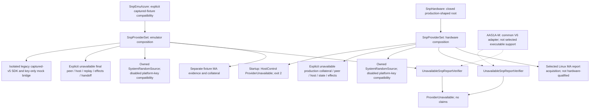

# Frozen provider-set composition

Read with the [freeze](task4-freeze.md). Solid selection arrows identify
current ownership; the future common verifier is explicitly separate.

- The [typed root](../../../src/pal/src/composition.rs) owns separate selected
  service seams. A capability flag is not an implemented service.
- The [legacy bridge](../../../src/migtd/src/snp_composition.rs) is not the
  common V6 verifier or typed V2 installer. Its historical SDK trust tag does
  not authorize production fixture evidence.
- The [Linux adapter](../../../src/pal/src/snp/hardware/mod.rs) targets the
  calling MA's report; it is not a tenant-report acquisition API. Current
  production startup stops before invoking it.
- The final common emulator contract requires authenticated signed supplement
  evidence and fixture provenance. Task6/AAS1A-M must supply and qualify it.
  Production forbids fixture supplement/roots and must retain the named raw
  V6 layout blocker. Today the selected verifier returns unavailable first.
- Operation-local host-pushed tenant evidence borrows the common verifier and
  selected replay/state services. It is not a freely injectable provider-set
  slot. Missing durable state never means an empty authorized journal.
- TDX/AzCVMEmu retain their existing paths. No runtime probing, TAV fallback,
  production mock, successful unavailable fallback or derived-key prerequisite
  is introduced.

The two-process inter-node and local planned-handoff conformance cases stop
at unavailable typed peer services in both compositions and roles. They do
not demonstrate a two-process local-handoff runtime.
