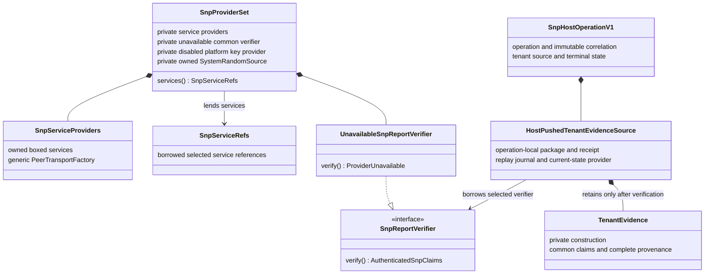
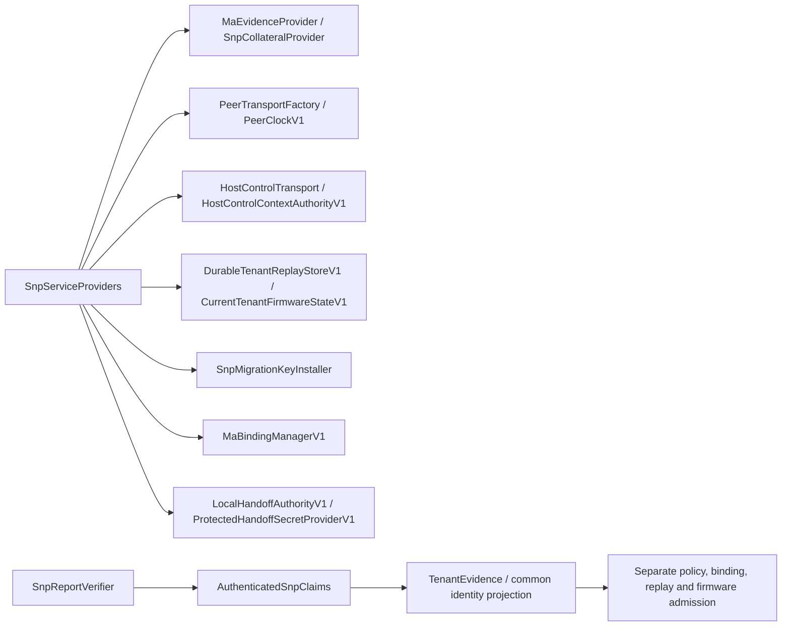
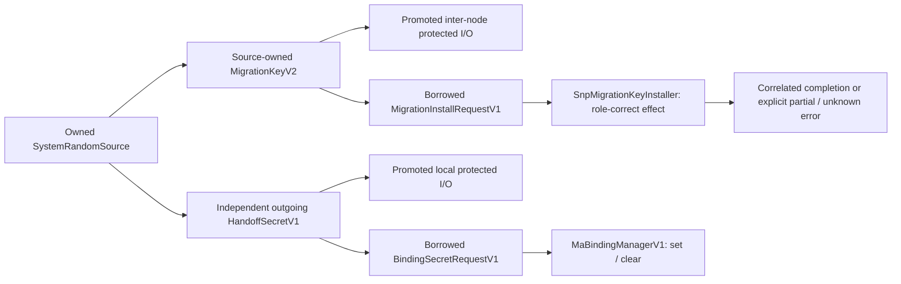

# Frozen Rust ownership and provider interfaces

T4.20 records implemented types, not proposed platform adapters. Availability
and downstream obligations are in the [freeze](task4-freeze.md) and
[consumer matrix](consumer-readiness-matrix.md).

## Selected ownership

The [provider set](../../../src/pal/src/composition.rs) is generic over a
composition marker and peer factory. Its owned boxes are not an `Arc` plugin
registry. Emulator construction accepts trusted services, not a replacement
verifier or RNG. Hardware construction is closed. Borrowed `SnpServiceRefs`
does not permit replacing selections.

The [process root](../../../src/migtd/src/snp_composition.rs) shares the
selected emulator root explicitly with WFR and both SPDM roles. Its
single-threaded `Rc<RefCell<...>>` handle is not the ownership type of every
PAL service. Tenant evidence is operation-local, not a provider-set field.

## Frozen service surfaces

Evidence acquisition, verification, policy approval, durable authorization and
effects are distinct capabilities. The selected common verifier cannot yet
produce claims. Receipt/private-constructor checks are not a claim that the
unavailable production services exist.

## Secret and effect ownership

These are implemented contracts and logical transitions, not active V2
transport or firmware effects. Secrets are owned/zeroizing and redacted;
borrowed requests do not clone them. Host control never carries either
secret. No `MigrationStateStore`, injected tenant-provider slot,
`AzureSnpEvidenceVerifier`, or operational Underhill peer implementation is
asserted by this diagram.
