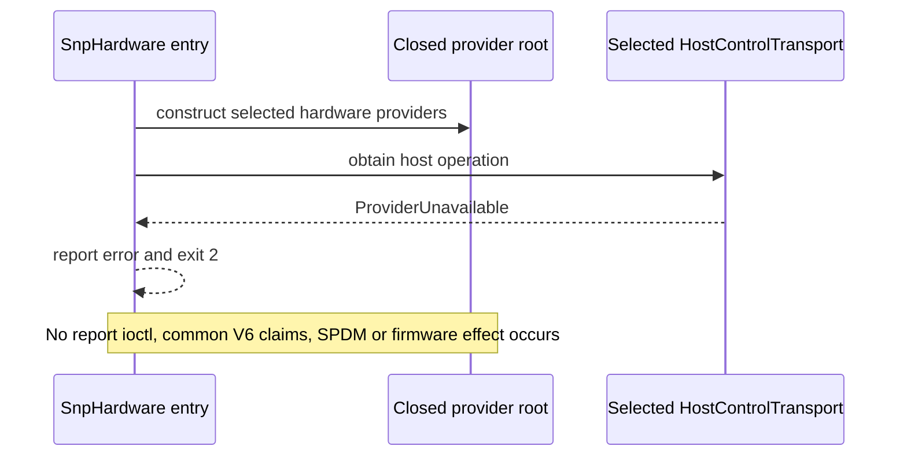

# Frozen current paths and deferred runtime sequences

These diagrams distinguish current execution from downstream contracts.
See the [consumer-readiness matrix](consumer-readiness-matrix.md).

## Current hardware startup



Current emulator WFR and SPDM callers share one explicit process root for
separate captured MA report/collateral and isolated SDK/key-only legacy
compatibility. They do not execute the future sequence below.

## Future inter-node V2 consumers: Tasks6-11/13/14

```mermaid
sequenceDiagram
    participant Host as Untrusted host control
    participant Src as Source MA
    participant Dst as Destination MA
    participant Verify as Qualified common verifier and policy
    participant State as Authoritative replay and firmware state
    Host->>Src: correlated request and complete source tenant evidence
    Host->>Dst: same complete source tenant evidence
    Src->>Verify: independently verify host-zero tenant evidence
    Dst->>Verify: independently verify host-zero tenant evidence
    Src->>Dst: establish protected SPDM; retain actual TH1
    Src->>Verify: fresh purpose6 evidence and fixed-policy pair appraisal
    Dst->>Verify: same operation, both roles, independently appraised
    Src->>Verify: fresh purpose7 and exact authorization325
    Dst->>Verify: verify source-MA binding and reciprocal role proofs
    Src->>State: authorize anchored replay and current state
    Dst->>State: authorize anchored replay and current state
    Note over Src,Dst: Independently admit identical history64 and reconstruct session703
    Src->>Src: generate final random32 MSK once for this admitted operation
    Src->>Dst: 0x30 protected MSK delivery
    Dst-->>Src: 0x31 protected acceptance
    Src->>Dst: 0x32 destination completion poll
    Dst->>State: role1 install same MSK32 and history64
    Dst-->>Src: 0x33 correlated destination outcome
    Src->>State: role0 install only after admitted destination completion
    Src->>Dst: 0x34 correlated source outcome
    Dst-->>Src: 0x35 source completion acknowledgement
    Note over Src,State: Partial or unknown effects require reconciliation, never blind regeneration
```

This sequence is an obligation, not a new running protocol. Protected I/O
receipts, constructor/shape checks, policy admission and firmware effects are
different authorities. There is no contribution, HKDF, application HMAC or
attested-persistence inference. Task12/purpose3 is deferred and is not a
current Task13/14 readiness prerequisite.

## Future local planned handoff and recovery: Phase4

```mermaid
sequenceDiagram
    participant Base as Untrusted BASE orchestration
    participant Old as Outgoing MA
    participant New as Incoming MA
    participant FW as Authoritative firmware-state owner
    Base->>Old: PrepareMaHandoffRequest with exact operation and tenant set
    Base->>New: same scoped handoff
    Old->>New: independent local SPDM and purpose4 prepare evidence
    Note over Old,New: Same FixedReleaseV1 identity; roles, epoch, attempt, stage and set admitted
    Old->>New: versioned nonsecret metadata
    Old->>Old: generate independent outgoing random32 handoff secret
    Old->>New: protected local secret delivery
    Old->>FW: install outgoing secret slot
    New->>FW: install incoming secret slot
    Old-->>Base: MaHandoffReady
    New-->>Base: matching MaHandoffReady
    Base->>FW: modeled SNP_REBIND_MA per tenant
    FW-->>Base: authoritative per-tenant result and preserved history64
    Base->>New: exact MaRebindResult
    Note over Old,New: Verify purpose4 firmware-result evidence and reconcile split ownership
    Base->>Old: FinalizeMaHandoff only after required confirmation
    Old->>FW: clear outgoing slot with VALID=0
    New->>FW: clear incoming slot with VALID=0
    Base->>FW: prove authoritative no-old-bindings inventory before stopping old MA
```

R4.1-R4.7 supply the stateful emulator/two-process runtime and negative tests;
H5.5/H5.7 qualify actual firmware, cleanup and shutdown inventory. Recovery is
incoming-only purpose5 with authoritative identity/current binding/history;
it has no old/new SPDM or handoff secret. Local messages remain logical typed
contracts, not an already qualified Underhill wire ABI. A local handoff secret
never crosses the inter-node channel or host control.
